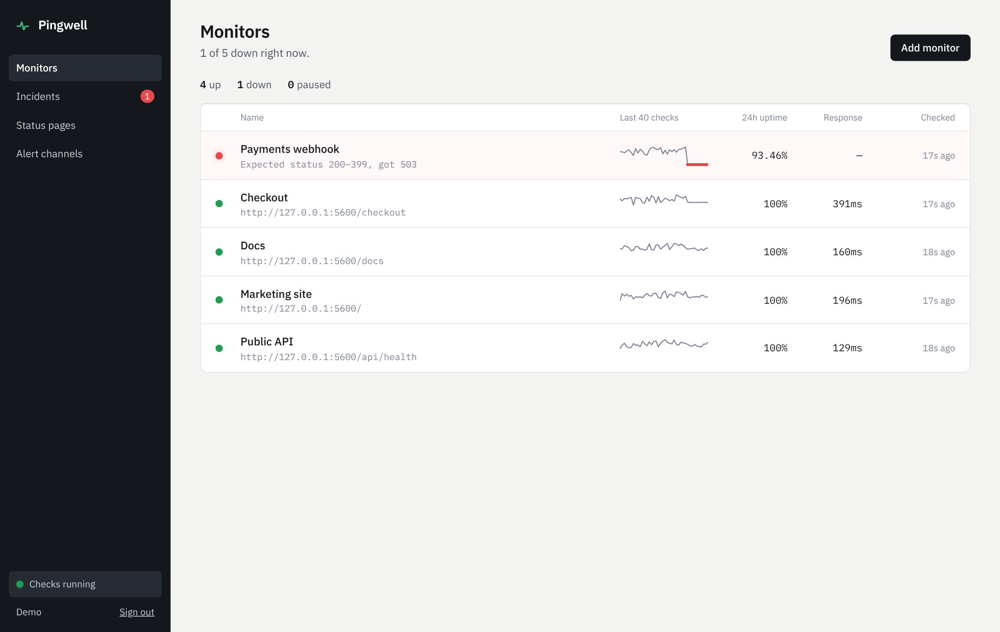
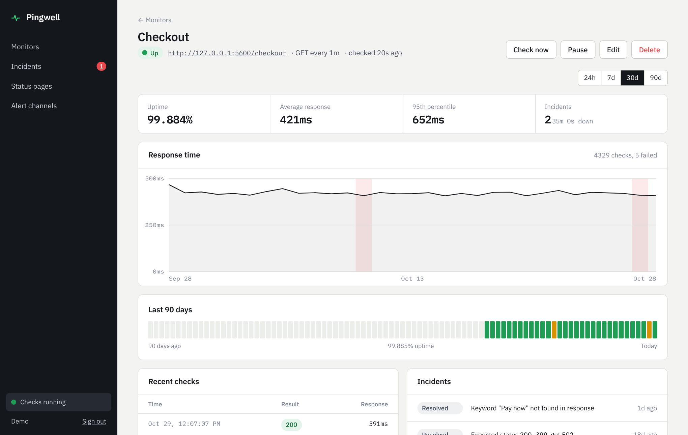
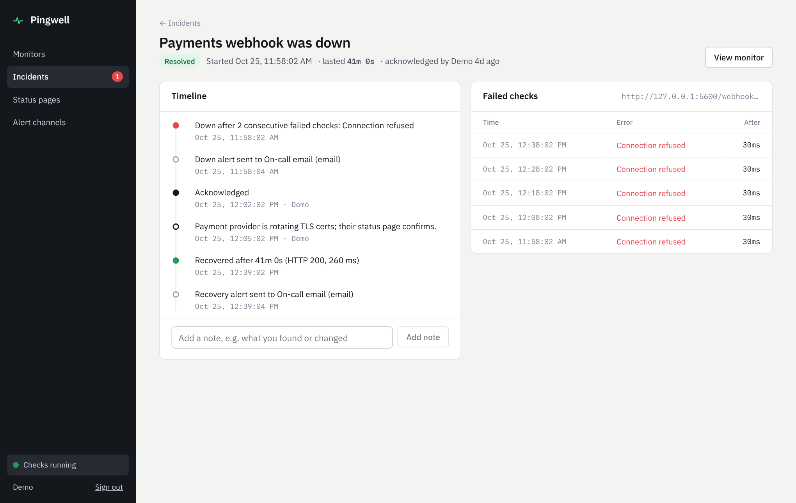
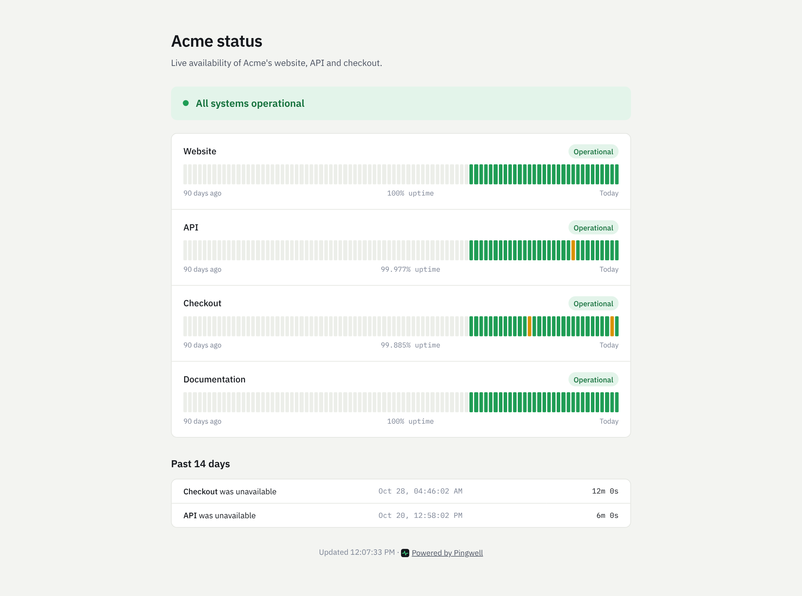
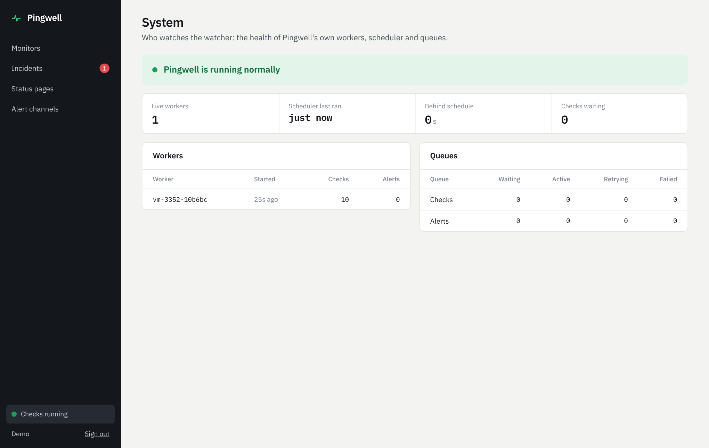
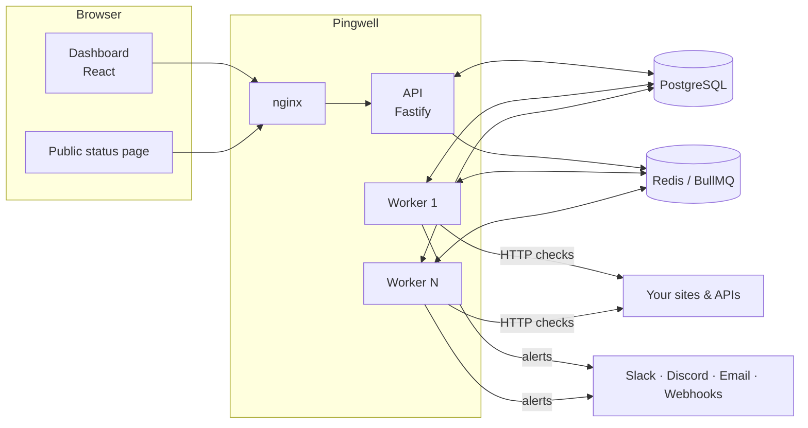

# Pingwell

Self-hosted uptime monitoring and incident management. Pingwell checks your websites and APIs on a schedule, opens an incident when they go down, alerts you on Slack, Discord, email or a signed webhook, and gives your customers a public status page.



## What it does

- **HTTP checks** every 30 s to 1 h: GET/HEAD/POST, custom headers and body, an accepted status range, an optional "page must contain" keyword, and timeouts. Redirects are followed hop by hop.
- **Incidents without noise.** A monitor goes down only after *N* consecutive failures and recovers only after *M* consecutive successes, so one-off blips and flapping don't page anyone.
- **Alerts** to Slack, Discord, email (SMTP) and generic webhooks signed with HMAC-SHA256. Failed deliveries retry with exponential backoff. Every alert is delivered at most once.
- **Incident timelines** that show when a monitor went down, which alerts went out, who acknowledged it, the team's notes and when it recovered.
- **Public status pages** with 90-day uptime bars and recent incidents. They never expose internal URLs or error messages.
- **Response-time charts**, p95 latency, uptime over 24 h, 7 d, 30 d and 90 d, plus a check log.
- **It monitors itself.** Worker heartbeats, scheduler lag, queue depth, a `/system` page, Prometheus metrics, and an optional dead man's switch.

| Monitor detail | Incident timeline |
| --- | --- |
|  |  |

| Public status page | System health |
| --- | --- |
|  |  |

## Architecture



| Part | Responsibility |
| --- | --- |
| `server/src/api` | REST API: auth, monitors, incidents, channels, status pages, health and metrics |
| `server/src/worker` | Scheduler loop, check consumer, alert consumer, outbox sweeper, retention, heartbeats |
| `server/src/monitoring` | SSRF-safe HTTP checker, pure incident engine, transactional result processing, scheduler |
| `server/src/alerts` | Channel senders and idempotent delivery |
| `web/` | Dashboard and public status page (React, TanStack Query) |

### How a check flows

1. **Schedule.** Every few seconds each worker runs one SQL statement that claims due monitors with `FOR UPDATE SKIP LOCKED` and moves their `next_check_at` forward. Any number of workers can do this at once without double-booking a monitor. Each claim is queued with a job ID derived from its time slot, so duplicates are ignored.
2. **Check.** A worker performs the HTTP request outside any database transaction. A target being down is a *result*, not an error.
3. **Record.** In one transaction, the worker locks the monitor row, stores the result, runs the [incident engine](server/src/monitoring/incident-engine.ts) and, if the state changed, opens or resolves the incident and writes one `alert_deliveries` row per channel. A partial unique index guarantees one open incident per monitor.
4. **Alert.** Deliveries are queued only after commit (a transactional outbox). If a worker crashes in between, a sweeper re-queues them. Delivery is idempotent: once a row is marked `sent`, retries are no-ops.

### Decisions worth calling out

- **SSRF protection.** Users submit URLs that your server then fetches. Pingwell refuses loopback, private, link-local (including the cloud metadata IP `169.254.169.254`), CGNAT and reserved ranges. It does this at *connect time*, after DNS resolution, which defeats DNS rebinding. It also checks every redirect hop and IPv4-mapped IPv6. Set `ALLOW_PRIVATE_TARGETS=true` only on private installs.
- **Thresholds live in a pure function**, [`evaluate()`](server/src/monitoring/incident-engine.ts), so the rules that decide when someone gets paged are covered by fast unit tests.
- **No catch-up storms.** If workers are down for hours, monitors resume on their next interval instead of firing every missed check at once.
- **Same-origin sessions.** nginx serves the dashboard and proxies `/api`, so the `HttpOnly`, `SameSite=Lax` session cookie never crosses origins and CSRF is blocked by default.
- **Retention.** Check results older than `RESULT_RETENTION_DAYS` are deleted in small batches so the hot table stays small.

## Quick start (Docker)

```bash
git clone https://github.com/Wealthometer/pingwell && cd pingwell
cp .env.example .env
# set JWT_SECRET in .env:  openssl rand -hex 32
docker compose up -d --build
```

Open <http://localhost:8080> and create an account. To run more checks in parallel, add workers:

```bash
docker compose up -d --scale worker=3
```

## Local development

Needs Node 22+, PostgreSQL 14+ and Redis 6+.

```bash
npm install
cp .env.example .env            # then point DATABASE_URL / REDIS_URL at your services
set -a && . ./.env && set +a
npm run migrate
npm run dev:api                 # http://localhost:4000
npm run dev:worker
npm run dev:web                 # http://localhost:5173 (proxies /api to :4000)
```

To get something to look at straight away, load a demo account with 30 days of history:

```bash
npm run seed:demo -w server     # sign in as demo@pingwell.dev / pingwell-demo, status page at /s/demo
```

## Configuration

| Variable | Default | Purpose |
| --- | --- | --- |
| `DATABASE_URL` | required | PostgreSQL connection string |
| `REDIS_URL` | required | Redis connection string (queues, heartbeats, rate limits) |
| `JWT_SECRET` | required | Signs session tokens. At least 32 characters. |
| `PUBLIC_APP_URL` | `http://localhost:5173` | Used in alert links |
| `CORS_ORIGIN` | `http://localhost:5173` | Allowed browser origin(s), comma-separated |
| `COOKIE_SECURE` | `false` | Set `true` behind HTTPS |
| `TRUST_PROXY` | `loopback,uniquelocal` | Proxies allowed to set `X-Forwarded-For`. The default trusts only private networks (like the bundled nginx). |
| `ALLOW_PRIVATE_TARGETS` | `false` | Allow checks to private and loopback addresses (SSRF risk) |
| `ALLOW_REGISTRATION` | `true` | Set `false` to close sign-ups once your team is in |
| `MIN_INTERVAL_SECONDS` | `30` | Shortest check interval users can choose |
| `CHECK_CONCURRENCY` | `25` | Concurrent checks per worker process |
| `SCHEDULER_INTERVAL_MS` | `5000` | How often each worker looks for due monitors |
| `RESULT_RETENTION_DAYS` | `90` | How long check results are kept |
| `MAX_MONITORS_PER_USER` | `50` | Per-account limit |
| `SMTP_URL` / `MAIL_FROM` | unset | Email alerts. Without SMTP, emails are logged instead. |
| `HEARTBEAT_URL` | unset | Pinged every minute, e.g. a healthchecks.io URL, so you hear about it if Pingwell itself stops |
| `METRICS_TOKEN` | unset | If set, `/metrics` requires `Authorization: Bearer <token>` |
| `RATE_LIMIT` | `true` | 300 requests/min per IP, 10/min on login and sign-up |

## Webhook payloads

Webhook channels receive a JSON `POST`:

```json
{
  "event": "incident.opened",
  "monitor": { "name": "Checkout", "url": "https://shop.example.com/checkout" },
  "title": "Checkout is down",
  "detail": "Expected status 200–399, got 502",
  "incident_url": "https://pingwell.example.com/incidents/…",
  "at": "2026-10-29T11:58:02.000Z"
}
```

`event` is `incident.opened`, `incident.resolved` or `test`. To verify a payload, check the `x-pingwell-signature: t=<unix>,v1=<hex>` header:

```js
const [, t, v1] = header.match(/t=(\d+),v1=([a-f0-9]+)/)
const expected = crypto.createHmac("sha256", SECRET).update(`${t}.${rawBody}`).digest("hex")
const valid = crypto.timingSafeEqual(Buffer.from(v1), Buffer.from(expected)) && Date.now() / 1000 - t < 300
```

## Operating it

| Endpoint | Use |
| --- | --- |
| `GET /health` | Liveness: the API process is up |
| `GET /health/ready` | Readiness: PostgreSQL and Redis are reachable (503 otherwise) |
| `GET /metrics` | Prometheus metrics from the API: requests and queue depth |
| `:9465/metrics` on each worker | Checks by result, check latency histogram, scheduler lag, incidents opened and resolved, alert outcomes |
| `GET /api/system` | Live workers, scheduler last tick and lag, queue counts, and a healthy, degraded or down verdict |

Both processes shut down gracefully on `SIGTERM`: the API drains requests and workers finish in-flight jobs.

## Tests

```bash
npm test
```

The suite has 91 tests: unit tests plus integration tests against real PostgreSQL and Redis (set `TEST_DATABASE_URL` and `TEST_REDIS_URL`). They cover:

- incident thresholds and anti-flapping
- SSRF blocking, including mapped IPv6 and redirects
- real HTTP checks: timeouts, keywords, refused connections
- auth and argon2 hashing, and isolation between users
- one incident when results race
- alerts delivered at most once, retries and final-failure logging, the outbox sweep
- schedulers never double-claiming a monitor
- status pages not leaking internals
- rate limiting

CI runs typechecking, the tests, the web build and both Docker image builds on every push.

## Tech

TypeScript, Node 22, Fastify 5, BullMQ, PostgreSQL, Redis, undici, Zod, argon2, pino, prom-client, React 19, TanStack Query, Vite, Vitest, Docker, GitHub Actions.

## Licence

MIT
